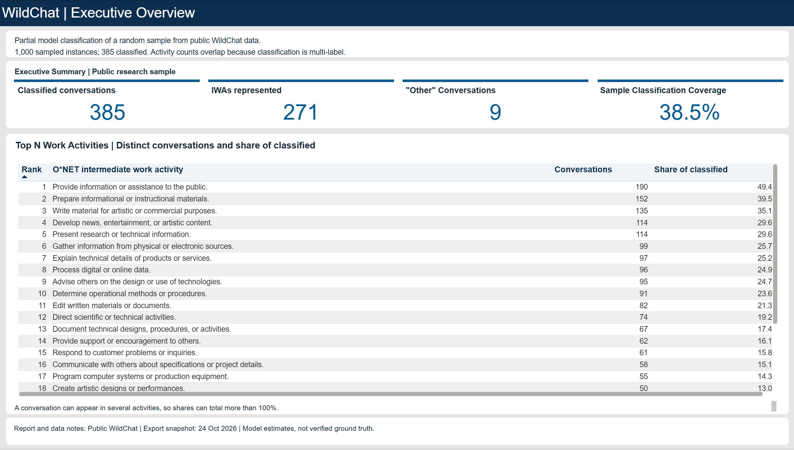
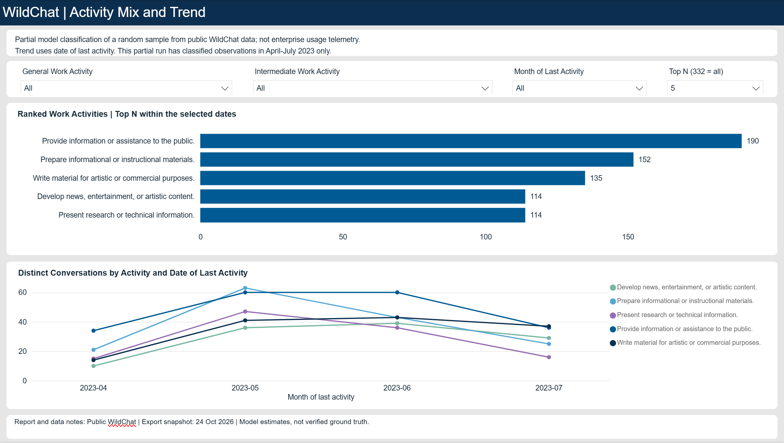

# Secure AI & Data Platform

A portfolio prototype of a privacy-conscious data pipeline that categorizes public AI conversations by O*NET work activity and presents aggregate results in Power BI.

> **Scope:** This project uses public WildChat research data.  The report reflects a partial sample, and category assignments are model estimates rather than verified ground truth.

## What it demonstrates

- A local Bronze/Silver/Gold pipeline for WildChat conversations and O*NET taxonomy data.
- A conversation-level model with separate conversation, category, and conversation-category tables. One conversation can map to multiple activities.
- Reproducible sample selection and resumable classification through the OpenAI Decisions API.
- Executive and activity-trend views in Power BI, built from the Gold CSV exports.

See the [architecture and data model](architecture/README.md), [dataset notes](data/README.md), and [Power BI report notes](reports/powerbi/README.md).

## Report preview

### Executive overview

### Activity mix and trend

The [semantic model screenshot](reports/powerbi/screenshots/semantic-model.png) is documented with the report notes.

## Data model

- **Conversations:** one row per source conversation instance. The key is derived from the first turn’s <code>turn_identifier</code>; the source timestamp denotes the last turn.
- **Categories:** O*NET Intermediate Work Activities (IWAs), plus the project-defined <code>OTHER</code> category.
- **Conversation categories:** one row per conversation/category assignment, forming the many-to-many bridge.

Category counts are distinct conversation counts. They overlap when a conversation has several labels, so category totals can exceed the classified-conversation total.

## Data handling

Conversation text is used for classification and excluded from report-ready Gold tables. Local source, working, and export data are excluded from Git. See [data handling notes](data/README.md) before downloading or processing the dataset.

## Repository map

- <code>architecture/</code> — system flow and analytics model
- <code>data/</code> — dataset profile and local data conventions
- <code>etl/bronze/</code>, <code>etl/silver/</code>, <code>etl/gold/</code> — ingestion, validation, classification, and reporting tables
- <code>notebooks/</code> — step-by-step local pipeline walkthrough
- <code>reports/powerbi/</code> — report screenshots and interpretation notes
- <code>infrastructure/terraform/</code>, <code>security/</code>, <code>monitoring/</code> — future platform capabilities

## Run locally

Requires Python 3.13. From the repository root:

    python3.13 -m venv .venv
    source .venv/bin/activate
    python -m pip install -r requirements-dev.txt
    python -m notebook notebooks/wildchat_pipeline.ipynb

The notebook downloads the source data and walks through Bronze, Silver, and Gold. Classification defaults to a reproducible 1,000-conversation sample, prompts for an OpenAI API key, and sends the selected conversation text to the API. API usage will incur charges; adjust the sample size in Step 7 before classification.

Azure deployment and the permission-aware RAG experience remain future work. This repository demonstrates a local data and reporting prototype.
