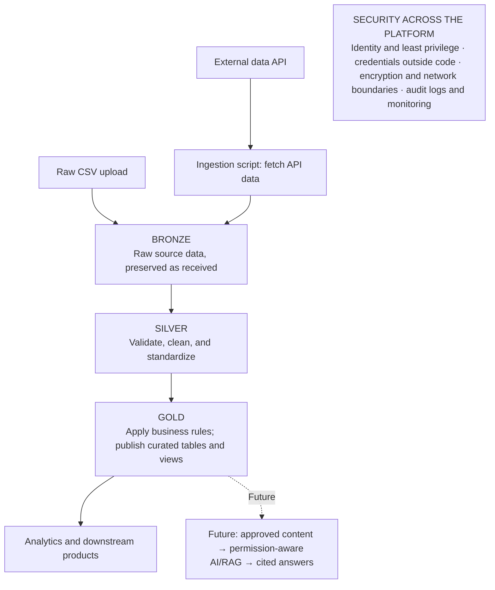
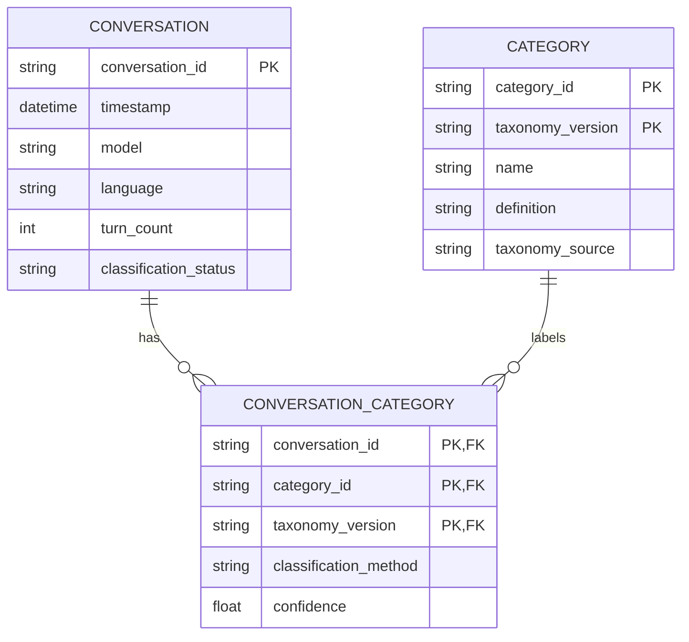

# Architecture Overview

The system architecture diagram and the initial conversation-category analytics model are both shown here. The full architecture design notes remain in [system-architecture.md](system-architecture.md).

## Initial System Architecture

This initial logical design keeps the data pipeline central. The AI/RAG path is a future consumer; Azure service choices and physical storage layout remain open.

## Initial conversation-category analytics model

The first reporting goal is to answer: **How many distinct conversations involved each category?** A conversation may involve several categories, so the relationship is many-to-many.

### Table roles

- **Conversation** — one row per source conversation. Use the dataset's `conversation_hash` as `conversation_id`; it identifies a conversation, not a person. Keep report-ready metadata here, not message text or network identifiers. `classification_status` can distinguish pending, classified, unclassified, or review-needed records.
- **Category** — one row per category in a taxonomy version, including its definition and source. The taxonomy version keeps reports reproducible when the category set changes.
- **Conversation category** — one row for each unique conversation-category assignment. Its composite key is `(conversation_id, category_id, taxonomy_version)`. `classification_method` can record human, rules-based, or model assignment; `confidence` is optional and should only be used when meaningful for that method.

For example, if conversation C1 includes coding and writing, it has two association rows. Count distinct `conversation_id` values per category. Category counts can overlap, so adding them may exceed the total number of conversations. This model counts whether a category appears in a conversation; it does **not** count how many times that kind of request occurred. Request-level counts would need a separate, finer-grained model.

The Silver JSONL remains the conversation-level processing artifact. This relational model describes a later analytics-ready Gold output; the category taxonomy and classification method are still to be selected.

## Classification taxonomy source

The work-related classification options are the unique **Intermediate Work Activities (IWAs)** from the [O*NET 31.0 GWA-to-IWA-to-DWA crosswalk](https://www.onetcenter.org/dictionary/31.0/csv/gwas_to_iwas_to_dwas.html). The source file has six columns and 2,087 crosswalk rows; it maps each Detailed Work Activity to one IWA and its General Work Activity. The classifier catalog deduplicates by IWA identifier rather than treating each crosswalk row as a category.

`OTHER` is a project-defined category for non-work-related conversations; it is not part of O*NET. A conversation can receive multiple IWA categories when it involves multiple work activities. A non-work conversation receives `OTHER`. Unclear or failed classifications should be marked for review instead of automatically mapped to `OTHER`.
