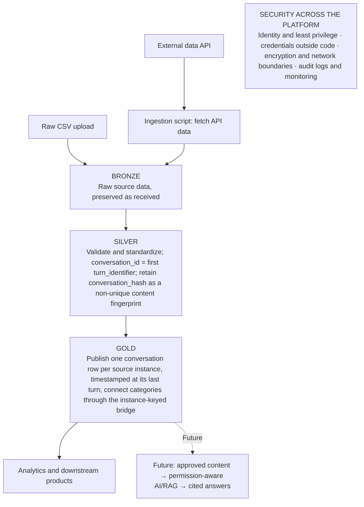

# Initial System Architecture

This initial logical design keeps the data pipeline central. The AI/RAG path is a future consumer; Azure service choices and physical storage layout remain open.

## Design notes

- The initial conversation-category analytics model is documented in [architecture README](README.md).

- The ingestion script writes the original API response to Bronze. Raw CSV files can be uploaded directly to Bronze.
- The local WildChat Bronze filename includes the row offset, requested length, and UTC date. A single-page rerun on the same UTC day replaces its file; full-split `--all --resume` skips pages saved that day, while a fresh `--all` refreshes them. The raw response is preserved as received, but historical reruns are not retained.
- The Hugging Face `/rows` endpoint allows at most 100 rows per request, so fetching the full split requires pagination.
- WildChat `conversation_id` is derived from the conversation’s first `turn_identifier`. The identifier is turn-grain; the first turn’s value is unique across the 837,989 conversation rows in the current local snapshot. `conversation_hash` is retained as a non-unique content fingerprint, never as the conversation key.
- The source conversation-level `timestamp` records the last turn. Gold preserves it and reports should label time trends as conversations by date of last activity.
- Bronze, Silver, and Gold are logical layers. Their physical storage layout and Azure services remain undecided.
- To execute the pipeline in separate Bronze/Silver/Gold scripts. The diagram separates the layers to show how data quality improves from raw input to consumer-ready output.
- To retrieve the credential from a secure store. An Azure-hosted workload can use a managed identity with only the storage permissions it needs.
- Considering using Jupter notebook to execute local implication with Azurite to emulate blob storage (DEV). 
- The dashed AI/RAG path is a future capability using approved data and authorization-aware retrieval.
