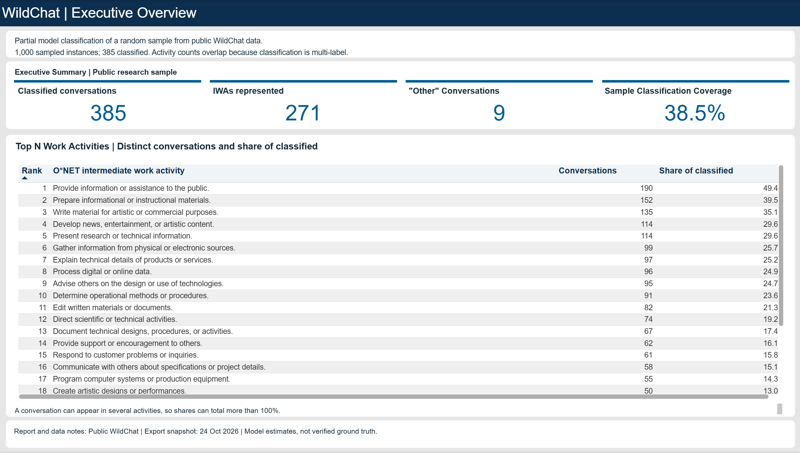
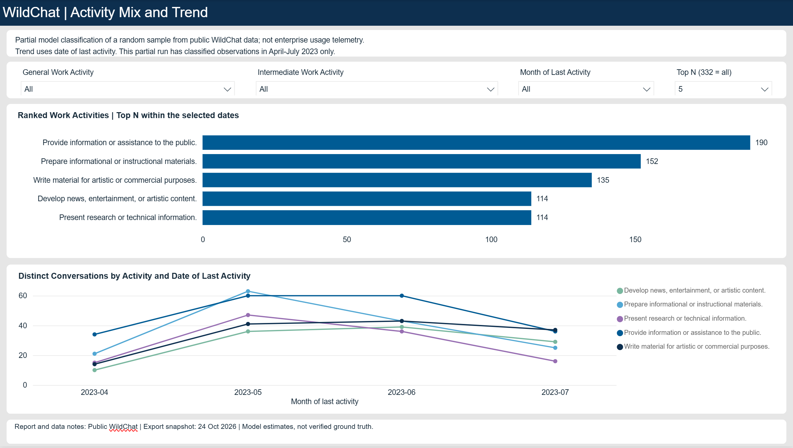
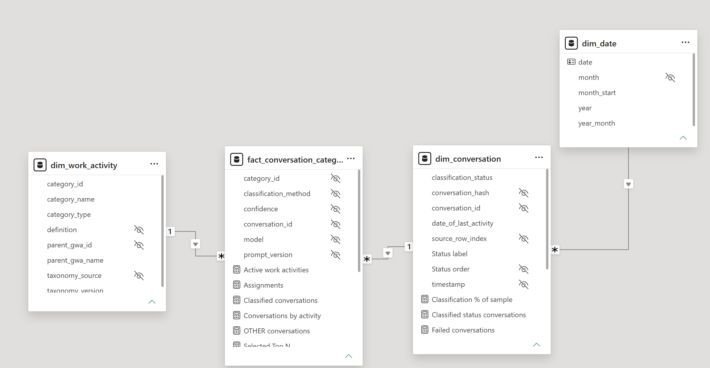

# Power BI Report

These screenshots document the current PBIP report. It uses a partial classification of a random sample from public WildChat research data. It is not real usage telemetry, and category assignments are model estimates.

## Report pages

### Executive overview

The summary cards show classified conversations, represented IWAs, <code>OTHER</code>, and sample classification coverage. The ranked table counts distinct conversations per activity. Counts and shares overlap because a conversation can receive multiple activity labels.

### Activity mix and trend

The trend uses each conversation’s last-activity date. It describes when the sampled conversations ended, not when they began or when each message occurred. This partial run has classified observations from April through July 2023 only.

## Semantic model

- <code>dim_work_activity</code> filters <code>fact_conversation_category</code> through <code>category_id</code>.
- <code>dim_conversation</code> filters the bridge through <code>conversation_id</code>.
- <code>dim_date</code> filters conversations through the date of last activity.
- The bridge has one row per conversation-category assignment; conversation counts should use a distinct count of <code>conversation_id</code>, not a count of bridge rows.

## Interpretation checks
1. Report is a partial model classification of public WildChat data.
2. Count distinct conversation IDs for category counts. A conversation assigned to several categories contributes once to each; counts and shares can therefore exceed the total and 100%.
3. Calculated sample coverage using only the selected 1,000-conversation sample.
5. Did not load conversation text or the classification review JSONL into the report. Do not infer users, teams, productivity, ROI, or spend.
