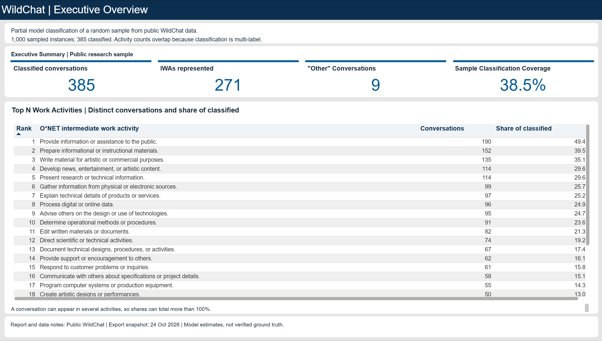
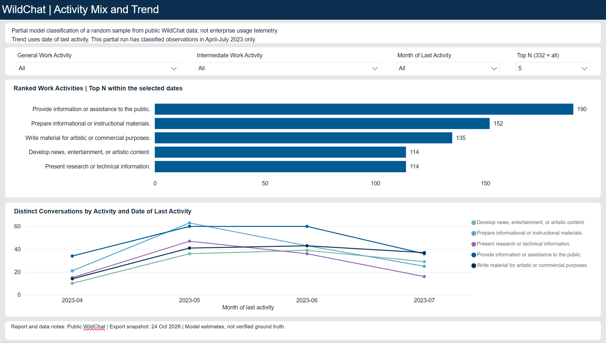
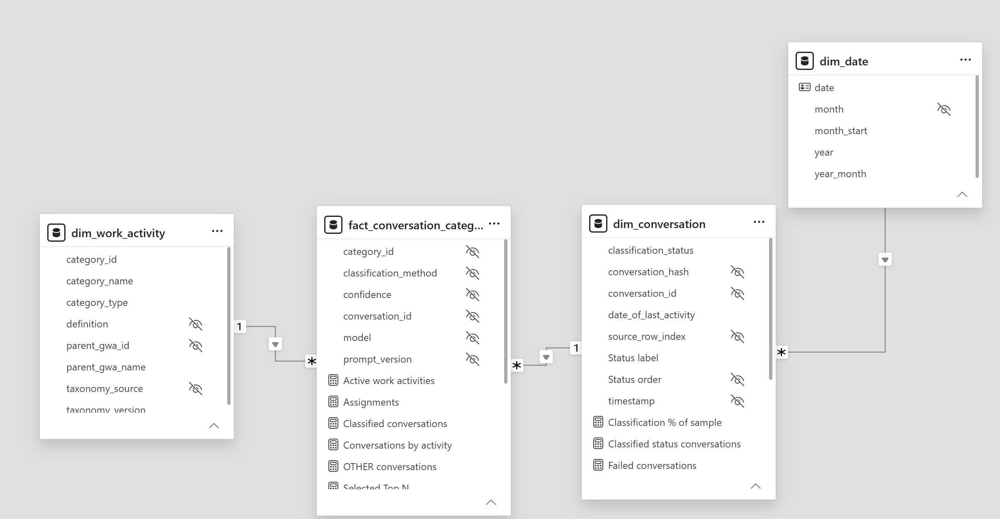

# Power BI report draft

These screenshots document the current PBIP report draft. The report uses a partial classification of a random sample from public WildChat data. It is not enterprise or MITRE usage telemetry, and the activity labels are model estimates.

## Report pages

### Executive overview

The summary cards distinguish classified conversations, represented IWAs, `OTHER`, and classification coverage. The ranked table counts distinct conversations for each activity. Counts and shares overlap because one conversation can receive multiple IWA labels.

### Activity mix and trend

The date visual uses the last-activity date from each conversation. It describes when the sampled conversations ended, not when each conversation began or when each individual message occurred.

## Semantic model

The relationships form a sound model for the current questions:

- `dim_work_activity` filters `fact_conversation_category` through `category_id`.
- `dim_conversation` filters the bridge through `conversation_id`.
- `dim_date` filters conversations through the date of last activity.
- The bridge contains one row per conversation-category assignment, so measures for conversation counts must use a distinct count of `conversation_id`, not a count of bridge rows.

Recommended checks as the model evolves:

1. Keep relationships one-to-many and single-direction from dimensions to the bridge. Keep the date relationship one-to-many from `dim_date` to `dim_conversation`. Avoid bidirectional filtering unless a specific measure needs it.
2. Define activity counts as distinct conversations from the bridge. A conversation assigned to multiple activities should count once in each activity, so activity counts and shares can sum above the classified-conversation total and 100%.
3. Define the sample-coverage denominator from sampled records only. In this export, `pending` records are outside the 1,000-record sample; counting the full conversation table would make coverage appear close to zero.
4. Keep the report explicit that monthly values are grouped by last activity. This snapshot’s partial classifications cover April through July 2023, so the trend is exploratory and should not imply a current enterprise trend.
5. `conversation_hash` can repeat and should not be used as a relationship key. `conversation_id` is the conversation-instance key.

The screenshot shows the three expected relationships and no obvious cardinality issue. The main risks are measure definitions and interpretation: counting assignment rows as conversations, including out-of-sample pending rows in coverage, or presenting this public partial sample as enterprise usage.
